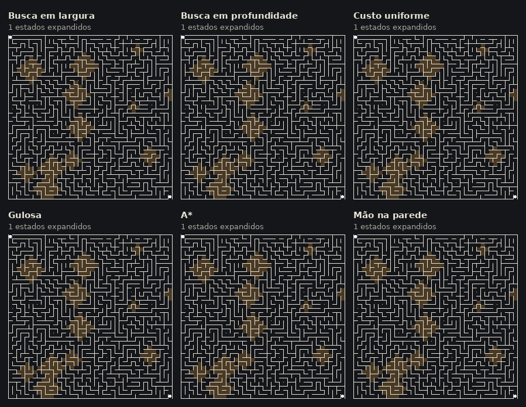

# Labirinto IA

Seis maneiras de sair do mesmo labirinto, correndo lado a lado, e um agente que aprende a sair sozinho.



O azul é tudo o que cada estratégia precisou olhar. O fio vermelho, como o fio de Ariadne no labirinto de Creta, é o caminho que ela encontrou. As manchas listradas são lama: custam 5 em vez de 1, e é aí que "caminho mais curto" e "caminho mais barato" deixam de ser a mesma coisa.

## O que tem aqui

- **Arena interativa** (`web/`): as seis buscas animadas juntas, com linha do tempo, velocidade, geradores de labirinto (backtracking, Prim e Kruskal), laços, lama e os labirintos originais de 2018. Clique no labirinto para mover a saída, mover a entrada ou pintar lama, e veja tudo ser recalculado na hora.
- **Placar**: estados expandidos e custo do caminho de cada estratégia, com a frase que resume quem ganhou e por quê.
- **Um agente que aprende sozinho**: Q-learning sem mapa. Ele começa perdido, apanha da lama e, em algumas centenas de tentativas, descobre a rota mais barata.
- **Pacote Python** (`labirinto/`): o mesmo núcleo, com linha de comando, imagens e GIF. Python e JavaScript usam o mesmo gerador de números (Mulberry32): com a mesma semente, os dois criam o mesmo labirinto e chegam aos mesmos números, e os testes conferem isso.

## As estratégias

| Estratégia | Como escolhe o próximo passo | Sempre acha a saída? | Acha o menor custo? |
|---|---|---|---|
| Busca em largura | Fila: explora em ondas, do mais perto ao mais longe | Sim | Só se tudo custa igual |
| Busca em profundidade | Pilha: segue um corredor até o fim antes de voltar | Sim, em grade finita | Não |
| Custo uniforme | O ponto mais barato de alcançar até agora (Dijkstra) | Sim | Sim |
| Gulosa | O ponto que parece mais perto da saída (distância de Manhattan) | Sim, em grade finita | Não |
| A* | Custo já pago mais a estimativa do que falta | Sim | Sim |
| Mão na parede | Sem mapa: mão direita sempre encostada na parede | Com entrada e saída na borda | Não |

No labirinto original de 100×100, todas acham o mesmo caminho (ele só tem um), mas a gulosa olha 919 estados, o A* 4.487 e a busca em largura 6.532.

## Como rodar

### Arena no navegador

```bash
cd web
python3 -m http.server 8000
```

Abra `http://localhost:8000`. Não há build nem dependências: são módulos JavaScript puros. Atalhos: espaço pausa, setas avançam ou voltam, R sorteia um labirinto novo.

### Linha de comando

```bash
pip install -r requirements.txt

# placar no labirinto original de 2018, com uma imagem por busca
python -m labirinto resolver labirintos/labirinto.png --saida resolv

# labirinto novo, com laços e lama
python -m labirinto resolver --gerar 40 --lacos 0.3 --lama 0.15 --semente 7

# GIF da corrida (o do topo deste README)
python -m labirinto gif --gerar 40 --lacos 0.35 --lama 0.12 --semente 2018 --saida docs/corrida.gif
```

Saída do `resolver`:

```
algoritmo                 achou    custo   passos  expandidos  fronteira  tempo (ms)
------------------------------------------------------------------------------------
Busca em largura            sim      372      373        6532         42        6.05
Busca em profundidade       sim      372      373        6961         53        7.28
Custo uniforme              sim      372      373        6532         42        9.62
Gulosa                      sim      372      373         919         46        1.57
A*                          sim      372      373        4487         44        7.53
Mão na parede               sim     9690     9691        9691          1        4.03
```

### Testes

```bash
pip install -r requirements-dev.txt
python -m pytest          # Python
cd web && npm test        # arena (Node 20+), inclui a paridade com o Python
```

Os testes conferem que todo caminho é válido (nada atravessa parede), que custo uniforme e A* sempre acham o menor custo, que os geradores criam labirintos perfeitos, que os labirintos de 2018 são lidos corretamente e que o agente de Q-learning aprende a sair. O arquivo `tests/fixtures/paridade.json` é gerado pelo Python (`python tests/paridade.py`) e conferido pelo JavaScript.

## Estrutura

```
labirinto/          núcleo Python: modelo, geradores, buscas, desenho e linha de comando
web/                arena interativa (index.html, style.css, js/core.js, js/app.js)
labirintos/         as imagens originais de 2018 (20×20, 100×100 e 200×200)
tests/              testes Python e a fixture de paridade
docs/               GIF e imagens do README
```

## História

Projeto da disciplina de Inteligência Artificial, criado em 2018 e revitalizado em 2026. A versão original lia os labirintos de imagem pixel a pixel e já comparava as cinco buscas clássicas. A revitalização corrigiu o custo uniforme e o A* (que não acumulavam o custo do caminho), trouxe de volta um módulo que faltava e impedia o projeto de rodar, e acrescentou a arena, a lama, os laços, a mão na parede e o agente que aprende.

## Autores

Charles Henrique ([@CharlesSantos2018](https://github.com/CharlesSantos2018)), Douglas Calora ([@DouglasCalora](https://github.com/DouglasCalora)), Elias Assunção ([@eliasassuncao](https://github.com/eliasassuncao)), Guilherme Haynes, Leonardo Pontes ([@leonfpontes](https://github.com/leonfpontes)) e Lúcio Sam ([@Sam753](https://github.com/Sam753)).
